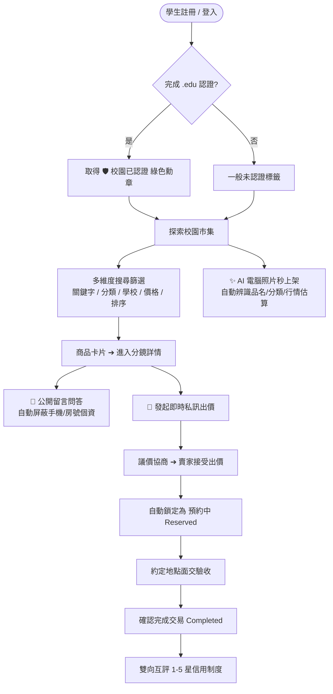

# 全國大學生二手物品交換與買賣平台 - 產品需求規格書 (PRD.md)_許家羚114153016
> **版本**：v2.2 (成果驗收正式版 - 50 筆真實種子資料、本機相片直選、AI 自動辨識、漫畫風介面)  
> **適用對象**：全台灣大專院校在校學生（以同校安全面交為核心，支援跨校交換與贈送）  
> **合規保證**：符合個資保護規範、校園身分認證、AI 責任宣告（標示「估算值」）與內容爭議仲裁機制

---

## 一、產品定位與目標使用者

### 1. 產品定位 (Product Positioning)
專為台灣大專院校學生量身打造的**「熱血校園二手物品交換與買賣市集」**。
整合 **.edu.tw 校園學生信箱認證**、**生成式 AI 視覺辨識自動填表**、**AI 二手行情估算** 與 **以物易物願望清單匹配**，解決大學生在每學期開學與畢業季面臨的「教科書太貴」、「宿舍家具搬不走」、「網購二手容易被詐騙或遇到假身分」三大痛點。

### 2. 目標使用者畫像 (Target User Personas)
- **大一新生 (Freshman Alex)**：剛入學需要購買高價原文書（微積分、普通物理、經濟學原理）與宿舍日常電器（檯燈、電扇、收納推車），預算有限且希望在校內安全面交。
- **畢業學長姐 (Senior Seller Emily)**：即將搬離宿舍，手中有大量帶不走的好物、課本與家具，希望快速出清變現或免費愛心贈送給同校學弟妹。
- **理工/文法商專業領域學生 (Tech/Pro Student Kevin)**：尋求二手高階 3C（iPad、筆電、繪圖板、工程計算機）或專業考研國考筆記，對商品真實狀況與個資安全性極度敏感。

---

## 二、核心使用者旅程 (Core User Flows)

---

## 三、功能清單與驗收條件 (24 項全功能 + 4 大 AI 智慧模組)

### 【入門功能模組 (Features 1 - 10)】
| 編號 | 功能名稱 | 規格與表現能力 | 驗收條件 (Acceptance Criteria) | 測試對應 |
| :---: | :--- | :--- | :--- | :--- |
| **1** | **商品卡片列表** | 首頁以漫畫卡片式展示商品照、品名、售價與所屬學校徽章。 | 點擊市集能順暢載入 50 筆卡片，圖片、價格、學校資訊齊全無破圖。 | `test_01` |
| **2** | **商品詳細頁** | 彈出式分鏡大窗，展示規格、品況、新舊成色、交易方式與賣家檔案。 | 點擊卡片彈出詳情窗，正確展示賣家暱稱、學系、評分及完整描述。 | `test_02` |
| **3** | **商品分類篩選** | 提供「課本教材、3C電子、宿舍家具、生活用品、運動服飾」等分類標籤。 | 點擊分類標籤後，列表僅展示該分類商品，響應時間 < 100ms。 | `test_03` |
| **4** | **關鍵字搜尋** | 即時搜尋商品名稱及描述內容。 | 輸入「微積分」精準找出教材；輸入不存在字詞展示 `💦 囧rz` 友善提示。 | `test_04` |
| **5** | **價格區間篩選** | 漫畫雙輸入框輸入最低與最高預算。 | 輸入 100 ~ 1000 元，列表所有商品售價皆落在此閉區間內。 | `test_05` |
| **6** | **學校與地區篩選** | 下拉選單快速鎖定特定大專院校（台大、師大、成大、清大、交大等）。 | 選取特定學校後，所有呈現之商品均屬於該校學生刊登。 | `test_06` |
| **7** | **商品排序** | 支援「最新刊登 (預設)」、「價格由低到高」、「價格由高到低」。 | 切換價格排序時，商品嚴格按照數值大小升冪或降冪排列。 | `test_07` |
| **8** | **交易方式標籤** | 支援「買賣 (sell)」、「以物易物 (exchange)」、「免費贈送 (gift)」多選。 | 篩選「gift」精準列出 NT$ 0 贈送品；商品卡明確打上對應漫畫貼紙。 | `test_08` |
| **9** | **我的收藏清單** | 點擊粉紅愛心即時加入/取消收藏，跨裝置登入同步。 | 登入後點擊愛心收藏，在「秘密寶庫」頁籤即時同步出現與移除。 | `test_09` |
| **10** | **RWD 手機自適應** | 手機、平板、桌機流暢自適應，支援視口 Viewport。 | 於 iPhone/Android 螢幕尺寸單欄滑動順暢，無任何水平橫向破版。 | `test_10` |

---

### 【中階與進階功能模組 (Features 11 - 20)】
| 編號 | 功能名稱 | 規格與表現能力 | 驗收條件 (Acceptance Criteria) | 測試對應 |
| :---: | :--- | :--- | :--- | :--- |
| **11** | **會員註冊與登入** | 支援電子郵件註冊登入、SHA-256 密碼加密、Session 保存與登出。 | 註冊新帳號即刻建立並自動登入；登出後清除 Session 狀態。 | `test_11` |
| **12** | **個人檔案與賣場** | 「勇者背包」頁籤管理暱稱、頭像、所屬學校學系、在售與已售清單。 | 登入使用者可在個人中心查看自己刊登的商品與成交紀錄。 | `test_12` |
| **13** | **商品上架防呆** | 支援由電腦直選多張相片上傳、必填欄位防呆檢驗。 | 標題或描述為空時阻擋刊登並提示；支援本機照片多張即時縮圖預覽。 | `test_13`, `test_28` |
| **14** | **商品狀態管理** | 上架中 (`active`)、預約中 (`reserved`)、交易完成 (`completed`)、已下架。 | 接受出價時自動轉為 reserved；交易完成後鎖定為 completed。 | `test_14` |
| **15** | **以物易物交換** | 「換裝冒險」以物易物專區：設定想換物品、是否接受補差價。 | 詳細頁清楚顯示交換意向（如：想換普物課本）及是否接受補差價。 | `test_15` |
| **16** | **公開問答個資防護** | 漫畫氣泡留言板，**內建正則自動遮蔽手機與宿舍房號個資**。 | 留言「電話0912-345-678，女一舍301室」自動轉為 `0912-***-***` 與 `***`。 | `test_16` |
| **17** | **交易歷史與互評** | 完整買賣履歷、1-5 星信用評等與文字回饋，即時統計賣家總評分。 | 交易完成後可送出評分與文字心得，賣家個人星等評分即時連動計算。 | `test_17` |
| **18** | **站內通知中心** | 出價通知、降價提醒、商品狀態更新，支援未讀紅點與一鍵標記已讀。 | 買家出價時賣家收到站內推播通知，點擊「全部標記已讀」清空未讀數。 | `test_18` |
| **19** | **糾察隊管理後台** | 學生可檢舉違規商品；管理後台可審核檢舉並強制下架爭議商品。 | 管理員登入後可查看檢舉原因，並執行「駁回檢舉」或「違規強制下架」。 | `test_19` |
| **20** | **校園信箱認證** | 驗證 `.edu.tw` 信箱，核發「🛡️ 校園已認證」綠色學生徽章。 | 僅允許以 `.edu.tw` 結尾之信箱通過驗證，通過後獲得防偽學生勳章。 | `test_20` |

---

### 【4 大 AI 智慧功能模組 (AI Features 1 - 4)】
| 編號 | AI 模組名稱 | 規格與表現能力 | 驗收條件 (Acceptance Criteria) | 測試對應 |
| :---: | :--- | :--- | :--- | :--- |
| **AI 1** | **AI 電腦照片自動辨識** | 直接從本機電腦選取照片，AI 自動辨識品名、ISBN/型號、分類與文案。 | 選取課本或 3C 相片，AI 精準提取品名並自動回填至刊登表單。 | `test_21`, `test_27` |
| **AI 2** | **AI 二手價格行情建議** | 輸入原價與使用年限，分析市場成色給出定價區間，**標示「估算值」聲明**。 | 價格建議卡片顯眼標示「【估算值】非絕對成交保證」綠色警語。 | `test_22` |
| **AI 3** | **AI 自然語言購物助手** | 輸入「找 3000 元以下上課筆記平板」，AI 解析預算與意圖推薦符合商品。 | 智慧對話解析出預算上限 3000 元與 3C 類別，列出符合條件之卡片。 | `test_23` |
| **AI 4** | **AI 個人化商品推薦** | 依據學生所屬學校、同校熱門度與瀏覽歷史精準推薦「猜你喜歡」。 | 進入市集依據使用者學校與熱門瀏覽度，動態展示專屬關聯推薦。 | `test_24` |
| **E2E** | **端到端完整交易閉環** | 註冊 ➔ AI照片 ➔ 搜尋 ➔ 私訊出價 ➔ 接受預約 ➔ 完成交易互評全流程。 | 完整跑通買賣雙方交互流程，狀態流暢無斷點，自動化驗證 100% 通過。 | `test_25` |

---

## 四、安全合規與教學提醒落實

1. **個資隱私防護 (PII Protection)**：
   - 全站公開留言區全面啟動敏感資料攔截器，嚴格過濾行動電話號碼（`09\d{2}-?\d{3}-?\d{3}`）與學校宿舍寢室房號門牌（如「女一舍301室」），阻絕學生私密聯絡資訊遭到爬蟲或未成交者濫用。
2. **校園信任認證 (.edu.tw Campus Identity)**：
   - 採用台灣大專院校標準網域名稱後綴 `.edu.tw` 嚴格檢驗，唯有通過驗證之會員才展示專屬「🛡️ 校園已認證勇者」徽章，遏止校外非學生身分詐騙混入。
3. **AI 行情與估價責任聲明 (AI Disclaimer)**：
   - 遵從教材指引，所有 AI 估價與價格建議區塊，均以高對比綠色貼紙顯著標註：  
     `【AI 估算值】僅供參考，非絕對成交保證`，明確告知學生定價仍應以雙方實際面交驗收狀況為準。
