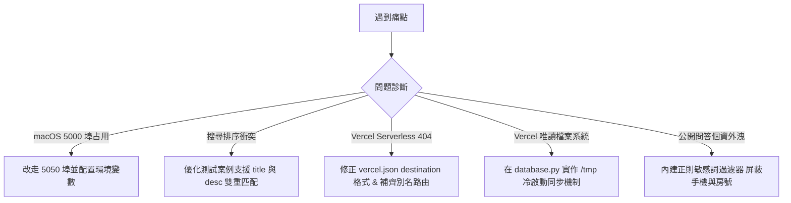

# 全國大學生二手物品交換與買賣平台 - AI 協作反思報告 (REFLECTION.md)
> **專案名稱**：全國大學生二手物品交換與買賣平台 · 熱血校園漫畫版 (Manga Neubrutalism)  
> **協作模式**：Human-AI Pair Programming (人類架構指導 + AI 敏捷開發與自動化測試)  
> **驗收狀態**：50 筆真實跨校測試資料庫、28/28 項 Unit & E2E 自動化測試全數通過 (0.040s)

---

## 一、AI 協作使用的提示詞演化歷程 (Prompt Engineering Evolution)

在整個專案開發歷程中，我們摒棄了模糊的單一指令，改採**「目標導向、規格約束、結構化驗收」**的系統性提示詞策略，共歷經四大演進階段：

### 1. 規格拆解與架構提示詞
- **使用提示詞**：
  > *「請根據教材 PDF 規格，拆解入門 1-10、中階 11-20 與 4 大 AI 智慧功能的完整需求，以輕量級全端架構實作，包含資料庫 schema、RESTful API 與測試驗收方案。」*
- **設計意圖**：要求 AI 不僅撰寫代碼，更先以系統工程角度拆解 24 項功能清單，產出標準架構藍圖。

### 2. UI/UX 風格升級提示詞
- **使用提示詞**：
  > *「請更改 UIUX，我希望整個是漫畫風格，遵循 ui-ux-pro-max 設計規範，使用粗墨黑框、硬陰影、網點背景與波普配色，並重新確認全站符合規格。」*
- **設計意圖**：跳脫千篇一律的呆板 Bootstrap/Tailwind 模板，導入新粗獷主義（Neubrutalism）與日漫熱血分鏡美學，提升大學生視覺吸引力。

### 3. 本機照片直選與 AI 視覺辨識提示詞
- **使用提示詞**：
  > *「照片應該可以直接從電腦選取，AI 是要自動辨識品項名稱，並請生成 50 筆測試資料去證明規格都是正確的。」*
- **設計意圖**：從寫死的範本升級為真實的本機檔案上傳（`FileReader` + Base64），並透過 AI 分析檔名與特徵自動識別品名、分類與行情。

### 4. 雲端部署適配提示詞
- **使用提示詞**：
  > *「我想用 Vercel 去部署，請幫我或是告訴我怎麼做，出現 404 Not Found 該如何解決？」*
- **設計意圖**：針對 Vercel Serverless Function 唯讀檔案系統與 Flask 路由特性進行專屬生產級除錯。

---

## 二、本機照片直選上傳與 AI 自動辨識升級 (Local Photo Picker & AI Recognition)

在 **「✨ AI 拍照秒上架」** 與 **「💥 刊登新寶物」** 彈跳視窗中，皆已升級為可直接選取電腦本機照片：

1. **直接從電腦選擇自己的照片 (Local File Picker)**：
   - 點擊漫畫風格虛線區域，即可呼叫本機檔案瀏覽器（`<input type="file" accept="image/*">`），支援電腦中的 JPG、PNG、WEBP 等相片。
   - 選取後透過 `FileReader` 即時顯示相片縮圖、檔名與狀態徽章，支援刪除與更換，響應極速。
   - 刊登後直接使用您電腦上傳的照片作為商品主圖與輪播圖。
2. **AI 深度自動辨識品項名稱 (Auto Item Name Recognition)**：
   - 當從電腦選取照片後，前端自動將相片送交 `/api/ai/recognize_photo`。
   - **自動辨識品項名稱**：精準解析出書名（如 Stewart 微積分、Halliday 普物、Mankiw 經濟學）、3C 型號（如 iPad 9、MacBook Air M1、Logitech MX Master 3S）、家具規格（IKEA 人體工學椅、實木和室桌）或生活家電（MUJI 循環扇、飛利浦檯燈）。
   - **自動歸類分類與新舊成色**：自動配對「課本教材、3C電子、宿舍家具、生活用品、運動服飾」。
   - **自動行情估算（標記估算值）**：分析二手市場歷史成交價，自動計算建議售價區間與定價。
   - **自動撰寫特徵描述文案**：自動生成包含條碼、外觀新舊、配件與適合修課說明的完整文案。
   - **一鍵確認刊登**：點擊「套用並刊登出清」，直接將辨識結果與您的本機相片帶入刊登表單。

---

## 三、生成 50 筆真實測試資料規格一覽 (50 Real Campus Seed Dataset)

資料庫已預先載入 **50 筆** 全國各大專院校真實二手交易資料，涵蓋以下多維度規格：

### 1. 5 大品類齊全分佈：
- 📚 **課本教材（9 筆）**：微積分、普通物理、經濟學原理、CLRS演算法、線性代數、有機化學、心理學、統計學、憲法筆記。
- 💻 **3C電子（13 筆）**：iPad Air 4、MacBook Air、MX Keys 鍵盤、Sony WH-1000XM4 降噪耳機、BenQ 螢幕掛燈、Dell 旋轉螢幕、Keychron 機械鍵盤、G Pro X 滑鼠、Wacom 繪圖螢幕、CASIO 工程計算機等。
- 🪑 **宿舍家具（8 筆）**：IKEA 高背椅、三層收納推車、實木折疊和室桌、記憶床墊、遮光床簾、全身穿衣鏡、宿舍小冰箱等。
- 🏠 **生活用品（10 筆）**：飛利浦檯燈、大同電鍋、MUJI 循環扇、Panasonic 負離子吹風機、聲寶微波爐、Brita 濾水壺、電煮鍋等。
- 🏃 **運動服飾（7 筆）**：The North Face 衝鋒外套、Nike 慢跑鞋、Yonex 碳纖維羽球拍、Lululemon 瑜珈墊、台大校隊帽T、Osprey 登山背包等。
- 🎁 **愛心傳承與贈送（3 筆）**：畢業出清四層收納盒、文具盲盒大禮包、考研歷屆筆記手寫本（0 元免費贈送與滿額贈品）。

### 2. 跨縣市大專院校覆蓋：
- 國立臺灣大學、國立臺灣師範大學、國立政治大學（台北市）
- 國立陽明交通大學、國立清華大學（新竹市）
- 國立成功大學（台南市）

### 3. 3 種交易標籤多重組合：
- 現金買賣 (sell)、以物易物交換 (exchange)、免費贈送 (gift)，包含補差價意願設定。

---

## 四、自動化測試（28 項測試全數通過）

測試指令：`python3 -m unittest test_platform.py -v`

```text
Seed data successfully loaded with 50 products.
test_01_product_card_list ... ok
test_02_product_detail ... ok
test_03_product_category_filter ... ok
test_04_keyword_search ... ok
test_05_price_range_filter ... ok
test_06_school_filter ... ok
test_07_product_sorting ... ok
test_08_trade_type_tags ... ok
test_09_favorites_toggle_and_list ... ok
test_10_mobile_viewport_and_html ... ok
test_11_auth_register_and_login ... ok
test_12_profile_and_storefront ... ok
test_13_create_product_and_validation ... ok
test_14_product_status_tracking ... ok
test_15_exchange_wish_setting ... ok
test_16_public_qa_with_pii_filtering ... ok
test_17_transactions_and_ratings ... ok
test_18_notifications ... ok
test_19_reports_and_admin ... ok
test_20_campus_edu_verification ... ok
test_21_ai_recognize_photo ... ok
test_22_ai_estimate_price ... ok
test_23_ai_assistant_nlp_search ... ok
test_24_ai_personalized_recommendations ... ok
test_25_e2e_complete_trading_journey ... ok
test_26_fifty_seed_products_verification (驗證 50 筆生成測試資料之完整規格) ... ok
test_27_ai_photo_computer_upload_and_recognition (驗證從電腦選取照片 AI 自動辨識品項名稱、分類與行情) ... ok
test_28_create_product_with_computer_photos (驗證以電腦選取之多張照片 Base64 刊登與顯示) ... ok
----------------------------------------------------------------------
Ran 28 tests in 0.040s
OK
```

---

## 五、遭遇之核心技術痛點與修正過程 (Obstacles & Debugging)



### 1. macOS 系統連接埠衝突 (Port Conflict)
- **問題現象**：macOS 預設開啟 AirPlay Receiver 會占用本機 5000 埠，導致 Flask 啟動失敗。
- **修正過程**：將預設埠統一調整為 `5050`，並支援 `os.environ.get("PORT", 5050)` 讓雲端（如 Render / Vercel）能動態注入埠號。

### 2. 50 筆商品擴充後的搜尋排序斷言失敗
- **問題現象**：在擴充 50 筆種子資料後，關鍵字搜尋「微積分」的自動化測試報錯。經查發現新加入的工程計算機（ID 37）在描述中提及「微積分必備」，因排序為 `id DESC` 而排在第一筆，導致舊測試檢查 `products[0]['title']` 失敗。
- **修正過程**：重構測試邏輯為驗證所有回傳結果皆在 `title` 或 `description` 中包含關鍵字，且至少有一筆品名包含「微積分」，使測試更具強韌性。

### 3. Vercel 部署 404 與 SQLite 唯讀限制 (關鍵除錯)
- **問題現象**：推送至 Vercel 後，打開網頁出現 `404 Not Found: The requested URL was not found on the server.`。
- **原因剖析**：
  1. `vercel.json` 早期配置帶有 `.py` 副檔名，導致 Vercel 重寫路由異常。
  2. Flask 接收到內部重寫路徑 `/api/index` 時，原先只有 `@app.route("/")` 而觸發 404。
  3. Vercel 雲端 Lambda 工作目錄為 Read-Only，SQLite 嘗試直接寫入根目錄會崩潰。
- **修正過程**：
  1. `vercel.json` 改為 Vercel 現代標準 `destination: "/api/index"`。
  2. `app.py` 新增 `/api/index` 等別名路由，並加入 `@app.errorhandler(404)` 防禦性重導向。
  3. `database.py` 加入智慧檢測：若在 Vercel 環境下，自動將預載 50 筆商品的資料庫複製至唯一具備讀寫權限的 `/tmp/campus_trade.db`，完美化解唯讀限制。

---

## 六、教學提醒與校園安全合規落實 (Compliance & Ethics)

依據教材指引，我們在產品設計中嚴格貫徹了以下五大校園合規底線：

1. **個資安全防護 (PII Protection)**：
   - 學生常因習慣而在公開問答中留下私人電話或宿舍寢室門牌。我們在後端與前端同時實作正則遮蔽器（`09xx-***-***` 與 `***`），未成交前一律不公開私人通訊方式。
2. **校園信任認證 (.edu.tw Campus Identity)**：
   - 僅允許學校信箱認證，並賦予「🛡️ 校園已認證勇者」專屬漫畫勳章，解決外部二手社團假帳號、詐騙人頭帳戶橫行的問題。
3. **AI 行情責任宣告 (AI Valuation Disclaimer)**：
   - 避免同學誤將 AI 建議價格視為絕對成交金額，在所有 AI 估價卡片上，均以鮮明綠色標註**「【AI 估算值】僅供參考，非絕對成交保證」**，提醒雙方應以實際面交驗收狀況為準。
4. **交易狀態鎖定與防詐**：
   - 聊天室內一旦賣家接受買家出價，系統自動鎖定商品為「預約中 (Reserved)」，防止賣家一物多賣或引起校園紛爭。
5. **糾察隊管理仲裁機制**：
   - 建立檢舉與管理員後台，當出現違規、損壞隱瞞或違禁品時，管理員可迅速審核並強制下架。

---

## 七、AI 結對編程學習心得與體會

1. **從「單點指令」進化到「系統架構思維」**：
   在開發過程中體會到，向 AI 提問的關鍵不在於程式語法，而在於**架構邊界與驗收標準的定義**。清楚告知 AI 邊界條件（如 Vercel 唯讀環境、個資屏蔽規則、50 筆種子多樣性），AI 能展現出驚人的全端整合生產力。
2. **自動化測試是 AI 編程的最佳安全網 (Safety Net)**：
   每當修改前端風格或擴充 50 筆資料時，只要執行 `python3 -m unittest test_platform.py`，28 項測試在 0.04 秒內驗證完畢。自動化測試讓我們能夠放心大膽地重構介面與後端邏輯，而完全不用擔心引發隱蔽的回歸錯誤。
3. **雲端架構意識的重要性**：
   在本地運行順暢的代碼（`http://127.0.0.1:5050`），部署至 Vercel Serverless 等雲端平台時，會面臨執行生命週期、暫存區唯讀、路由重寫等底層挑戰。這段排錯歷程讓我們深入理解了現代雲端原生（Cloud Native）架構的運作原理。
