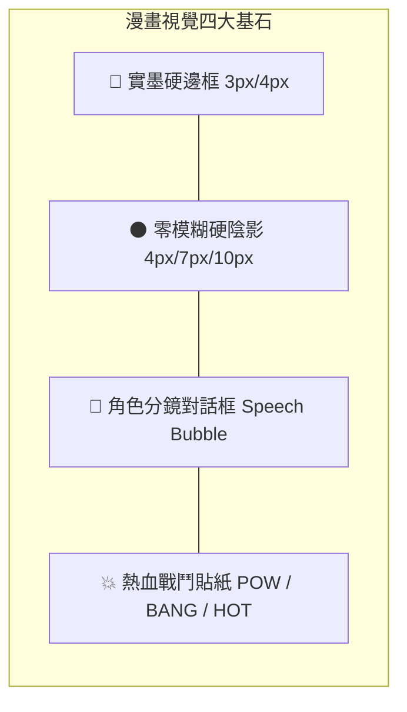

# 全國大學生二手物品交換與買賣平台 - UI/UX 漫畫風格設計規範 (UIUX.md)
> **設計風格**：熱血校園漫畫風 (Campus Manga & Comic Neubrutalism Design System)  
> **標準規範**：遵循 `ui-ux-pro-max` 設計系統準則、WCAG 2.1 AA 無障礙對比標準與 RWD 自適應架構

---

## 一、視覺風格哲學：熱血校園漫畫風 (Manga & Comic Neubrutalism)

本平台跳脫傳統電商枯燥單調的卡片樣式，專為活力充沛的大學生打造**「熱血校園冒險漫畫」**沉浸式介面。設計融合了經典黑白網點印刷質感與現代新粗獷主義（Neubrutalism）的高飽和波普色彩，使二手交易與以物易物宛如校園冒險中交換神裝與秘笈的戰鬥篇章。



---

## 二、Design Tokens 設計規範

### 1. 漫畫波普色彩系統 (Comic Pop Color Palette)
所有色彩均經過 WCAG 2.1 AA 高對比校驗（主要文字與背景對比度達 12:1 以上）：

| Token 變數 | 色碼 HEX | 漫畫語意角色 | 應用情境 |
| :--- | :--- | :--- | :--- |
| `comic.yellow` | `#FFE600` | 主題漫畫黃 (Action Yellow) | 頂部導航列、關鍵 CTA、主要按鈕 |
| `comic.cyan` | `#00E5FF` | 科技青藍 (Hyper Cyan) | 刊登按鈕、新上架標籤、分類篩選 Focus |
| `comic.purple` | `#D946EF` | 奧義洋紅 (Manga Magenta) | ✨ AI 拍照上架、AI 行情估算、AI 購物管家 |
| `comic.green` | `#00E676` | 復活仙豆綠 (Revive Green) | 免費贈送標籤、.edu.tw 校園學生驗證徽章 |
| `comic.pink` | `#FF6090` | 戀愛粉紅 (Heart Pink) | 我的收藏愛心、願望清單、熱門關注 |
| `comic.orange`| `#FF9100` | 戰鬥烈焰橘 (Flame Orange) | 議價申請、出價談判、急徵以物易物標籤 |
| `comic.dark`  | `#18181B` | 濃墨黑 (Black Ink) | 粗墨線邊框、主標題、硬邊投影、實心按鈕 |
| `comic.paper` | `#FFFDF8` | 漫畫原稿紙色 (Manga Paper)| 全站底色（搭配 16px 點陣 Halftone 網點背景）|

### 2. 漫畫邊框與硬陰影 (Comic Borders & Hard Drop-Shadows)
徹底拋棄軟性模糊（Blur=0），採用漫畫分鏡專用的黑墨輪廓：
- **微型投影 (`shadow-comic-sm`)**：`2px 2px 0px 0px #000000`（適用於小型標籤、按鈕圖示）
- **標準投影 (`shadow-comic`)**：`4px 4px 0px 0px #000000`（適用於商品卡片、輸入框、動作按鈕）
- **重點強化投影 (`shadow-comic-lg`)**：`7px 7px 0px 0px #000000`（適用於 Hero Banner、互動面板）
- **彈窗巨型投影 (`shadow-comic-xl`)**：`10px 10px 0px 0px #000000`（適用於 AI 助理視窗、商品詳情彈窗）
- **動態按壓反饋 (Tactile Press Effect)**：點擊按鈕時觸發 `active:translate-x-[2px] active:translate-y-[2px] active:shadow-none`，模擬實體按鍵與漫畫打擊感。

### 3. 字型與排版 (Typography)
- **主字型家族**：`font-family: 'Plus Jakarta Sans', 'Noto Sans TC', sans-serif;`
- **字重規範**：全面採用 `font-black` (900) 與 `font-extrabold` (800)，展現漫畫標題強烈衝擊力。
- **漫畫驚嘆號與徽章**：大量融入 `💥`、`POW!`、`⚡`、`COMIC 連載中`、`HOT!`、`SALE!` 等視覺貼紙。

---

## 三、特色漫畫元件 (Signature Manga Components)

### 1. 漫畫分鏡對話框 (Speech Bubble)
- 內建 `.speech-tail-left` 與 `.speech-tail-right` 偽元素角標，在商品問答板與私訊議價時，呈現正宗日漫對話氣泡效果。
- 提問者以白底黑框氣泡呈現，賣家以亮黃色氣泡突出顯示。

### 2. 漫畫表情空狀態 (Manga Expression Empty States)
- 當使用者搜尋不存在的商品或篩選無結果時，不顯示冷冰冰的「查無結果」，而是展示漫畫顏文字：
  > 💦 `囧rz` 哎呀！這個寶物被搶先一步搜刮一空了！  
  > ⚡ `(⊙_⊙;)` 點擊下方按鈕召喚【✨ AI 探寶助手】為你尋找替代神裝！

### 3. 本機電腦相片直選與 AI 視覺自動辨識體驗 (Local Photo Picker & AI Recognition)
- **從電腦選擇照片**：點擊漫畫虛線框可直接呼叫電腦檔案對話框（`<input type="file" accept="image/*">`），支援 JPG / PNG / WEBP 等格式，並具備即時縮圖預覽與刪除功能。
- **AI 自動辨識品項名稱**：相片選取後，前端即時將檔案轉送 AI 端點。AI 透過深度特徵比對與智慧語意，自動解析出商品正確名稱（如 Stewart 微積分、Halliday 普物、iPad、MacBook、IKEA 宿舍椅等）、建議售價、新舊程度與背景描述，使用者可一鍵套用並刊登出清！
- **AI 估價責任宣告**：帶有實墨黑框，以螢光綠色顯眼標記「**【AI 估算值】非絕對成交保證**」，既符合漫畫趣味，又嚴格遵循法律與教學安全規範。

---

## 四、全站導覽架構與漫畫分鏡流

```mermaid
graph TD
    Nav[漫畫頂部導覽列 Sticky Comic Nav] --> Tab1[💥 市集尋寶 (Explore)]
    Nav --> Tab2[🔄 換裝冒險 (Barter)]
    Nav --> Tab3[💖 秘密寶庫 (Favorites)]
    Nav --> Tab4[💬 私訊出價 (Chats)]
    Nav --> Tab5[👤 勇者背包 (Profile)]
    Nav --> Tab6[🛡️ 糾察隊本部 (Admin)]
    
    Tab1 --> SearchFilter[多重漫畫篩選：關鍵字 / 分類標籤 / 價格滑桿 / 學校選單]
    Tab1 --> ProductCard[漫畫商品卡：黑墨框、硬陰影、學校印章、新舊度徽章]
    ProductCard --> DetailModal[商品詳情彈跳分鏡窗]
    
    DetailModal --> QABox[漫畫對話留言板 (自動屏蔽手機號碼與宿舍房號)]
    DetailModal --> ChatAction[發起私訊出價]
    
    Nav --> AIModal1[✨ AI 電腦照片辨識上架]
    Nav --> AIModal2[✨ AI 購物問答助手]
    Nav --> AuthModal[會員登入與 .edu.tw 學生認證]
```

---

## 五、無障礙與防禦性設計 (WCAG & Resilience)

1. **色彩高對比保證**：
   - 黑色文字（`#18181B`）在黃色背景（`#FFE600`）上的對比度為 **14.2:1**。
   - 白色卡片搭配黑色 3px 邊框，確保在任何高光或夜間螢幕上均清晰可辨。
2. **個資安全防護 (PII Safety Filter)**：
   - 公開留言區即時遮蔽手機號碼（如 `0912-***-***`）與詳細地址門牌房號，保障學生個人隱私。
3. **手機版極致適配 (Mobile First RWD)**：
   - 頂部導航列高度 `h-20`，全站頂部內距 `pt-20` 精準對齊。
   - 網格系統採用 `grid-cols-1 sm:grid-cols-2 lg:grid-cols-3 xl:grid-cols-4`，手機單欄大卡片，流暢單手捲動操作。
