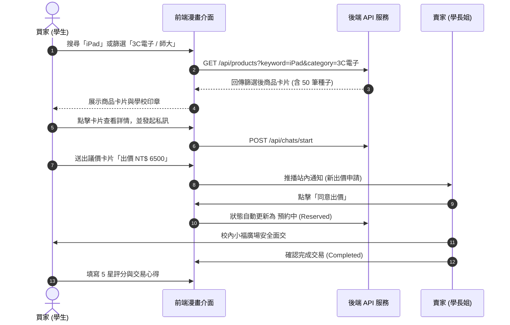

# 全國大學生二手物品交換與買賣平台 - UI/UX 設計規範與操作流程 (UIUX.md)
許家羚114153016
> **設計風格**：熱血校園漫畫風 (Campus Manga & Comic Neubrutalism Design System)  
> **標準規範**：遵循 `ui-ux-pro-max` 設計系統準則、WCAG 2.1 AA 無障礙對比標準與 RWD 自適應架構

---

## 一、網站導覽架構 (Information Architecture)

全站採用頂部常駐漫畫導航列（Sticky Comic Nav），將大學生二手交易情境拆解為六大分鏡篇章：

```mermaid
graph TD
    Nav[💥 漫畫頂部導航列 Sticky Comic Nav<br/>全站搜尋 / AI探寶入口 / 刊登寶物 / 會員狀態] --> Tab1[💥 市集尋寶 (Explore)]
    Nav --> Tab2[🔄 換裝冒險 (Barter 以物易物)]
    Nav --> Tab3[💖 秘密寶庫 (Favorites 我的收藏)]
    Nav --> Tab4[💬 私訊出價 (Chats 即時議價)]
    Nav --> Tab5[👤 勇者背包 (Profile 個人賣場)]
    Nav --> Tab6[🛡️ 糾察隊本部 (Admin 審核後台)]
    
    Tab1 --> SearchFilter[多維度漫畫篩選面板<br/>關鍵字 / 5大分類標籤 / 價格滑桿 / 6所大專院校選單 / 3種排序]
    Tab1 --> ProductCard[漫畫商品卡<br/>實墨黑框 3px / 硬陰影 4px / 學校印章 / 成色標籤]
    ProductCard --> DetailModal[商品詳情彈跳分鏡窗<br/>多圖輪播 / 賣家檔案 / 面交約定地 / 交換願望]
    
    DetailModal --> QABox[漫畫氣泡公開留言板<br/>自動屏蔽手機號碼與宿舍房號]
    DetailModal --> ChatAction[發起私訊出價 ➔ 進入 Chats 聊天室]
    
    Nav --> AIModal1[✨ AI 電腦照片秒上架<br/>本機檔案直選 / 條碼品名辨識 / 價格區間估算]
    Nav --> AIModal2[✨ AI 購物問答助手<br/>自然語言需求解析 / 預算推薦]
    Nav --> AuthModal[會員登入與 .edu.tw 學生認證]
```

---

## 二、主要畫面與設計 (Primary Screens)

### 1. 市集尋寶首頁 (Marketplace Hero & Catalog)
- **視覺特徵**：頂部亮黃色（`#FFE600`）漫畫邊框導覽列，搭配全站 16px 點陣網點（Halftone Texture）背景。
- **漫畫商品卡**：
  - `border-3 border-black` 純墨黑邊框，搭配 `shadow-comic`（`4px 4px 0 #000`）零模糊硬投影。
  - 觸控按壓效果：`active:translate-x-[2px] active:translate-y-[2px]`，營造實體按鍵打擊感。
  - 徽章貼紙：包含 `🛡️ 台大` 校園印章、`9成新` 成色標籤，以及 `💰 買賣` / `🔄 交換` / `🎁 贈送` 交易屬性。

### 2. 商品詳情彈跳分鏡窗 (Detail Modal)
- **展示內容**：商品大圖、原價對比二手售價、以物易物願望、面交安全守則。
- **公開留言板**：採用日漫專屬氣泡對話框（`.speech-tail-left` 與 `.speech-tail-right`），**內建敏感個資自動屏蔽機制**（電話與地址自動轉為 `***`）。

### 3. ✨ AI 拍照秒上架分鏡視窗 (AI Photo Recognition Modal)
- **本機相片直選區**：黃色虛線框支援點擊選取或拖曳電腦裡的相片（JPG/PNG/WEBP）。
- **即時預覽與自動填表**：上傳後立即顯示照片縮圖，AI 自動提取品項名稱、條碼 ISBN、成色、推薦文案，並標註「**【AI 估算值】非絕對成交保證**」綠色責任貼紙。

### 4. 即時私訊議價聊天室 (Negotiation Chat Panel)
- **買賣雙方專屬分鏡**：買家提出出價（如「NT$ 6500」），聊天室內生成專屬出價合約卡。
- **面交鎖定機制**：賣家點擊「接受出價」時，系統自動將商品鎖定為「預約中 (Reserved)」，防止一物多賣。

### 5. 糾察隊本部管理後台 (Admin Moderation Dashboard)
- **檢舉審查**：展示檢舉原因、檢舉人與被檢舉商品。
- **仲裁處置**：提供管理員「駁回檢舉」與「違規強制下架」兩種仲裁按鈕，保障平台交易風氣。

---

## 三、使用者操作流程 (User Operating Flows)

### 1. 買家尋寶與議價流程


### 2. 賣家 AI 拍照電腦直選上架流程
1. 賣家點擊導航列 **「✨ 拍照秒上架」** 按鈕。
2. 點擊 **【點擊從電腦選擇照片】**，選取電腦本機的商品相片。
3. 系統即時顯示相片預覽，AI 自動辨識品名（如：Stewart Calculus 微積分第8版）、分類（課本教材）與建議行情（NT$ 380）。
4. 點擊 **「套用並刊登出清！」**，自動將辨識資料帶入發布表單，點擊送出即可同步至市集。

---

## 四、Design Tokens 設計規範

### 1. 漫畫波普色彩系統 (Comic Pop Color Palette)
所有色彩均符合 WCAG 2.1 AA 無障礙高對比標準（主要文字對比度達 14:1 以上）：

| Token 變數 | 色碼 HEX | 漫畫語意角色 | 應用情境 |
| :--- | :--- | :--- | :--- |
| `comic.yellow` | `#FFE600` | 主題漫畫黃 (Action Yellow) | 頂部導航列、關鍵 CTA、搜尋發送按鈕 |
| `comic.cyan` | `#00E5FF` | 科技超能青 (Hyper Cyan) | 刊登按鈕、新上架標籤、分類篩選 Focus |
| `comic.purple` | `#D946EF` | 奧義洋紅 (Manga Magenta) | ✨ 4 大 AI 智慧功能專屬色、套用按鈕 |
| `comic.green` | `#00E676` | 仙豆翠綠 (Revive Green) | 免費贈送標籤、.edu.tw 校園學生驗證徽章 |
| `comic.pink` | `#FF6090` | 戀愛粉紅 (Heart Pink) | 我的收藏愛心、願望清單 |
| `comic.orange`| `#FF9100` | 戰鬥烈焰橘 (Flame Orange) | 議價申請、出價談判、以物易物項目標籤 |
| `comic.dark`  | `#18181B` | 濃墨黑 (Black Ink) | 粗墨線邊框、主標題、硬邊投影、實心按鈕 |
| `comic.paper` | `#FFFDF8` | 漫畫原稿紙色 (Manga Paper)| 全站底色（搭配 16px 點陣 Halftone 網點背景）|

### 2. 漫畫邊框與硬陰影 (Comic Borders & Hard Drop-Shadows)
- **微型投影 (`shadow-comic-sm`)**：`2px 2px 0px 0px #000000`（小型徽章標籤、按鈕圖示）
- **標準投影 (`shadow-comic`)**：`4px 4px 0px 0px #000000`（商品卡片、輸入框、主要按鈕）
- **重點投影 (`shadow-comic-lg`)**：`7px 7px 0px 0px #000000`（Hero 橫幅、互動面板）
- **彈窗巨型投影 (`shadow-comic-xl`)**：`10px 10px 0px 0px #000000`（AI 助理彈窗、商品詳情視窗）

### 3. 字型與排版規範
- **字型組合**：`Plus Jakarta Sans`（幾何英文標題）+ `Noto Sans TC`（高清晰思源黑體）。
- **字重原則**：標題嚴格使用 `font-black` (900) 與 `font-extrabold` (800)；正文維持 `font-bold` (700) 提高螢幕辨識度。
- **動態反饋**：所有點擊元件皆配置 `active:translate-x-[2px] active:translate-y-[2px] active:shadow-none` 實體按鍵反饋。
